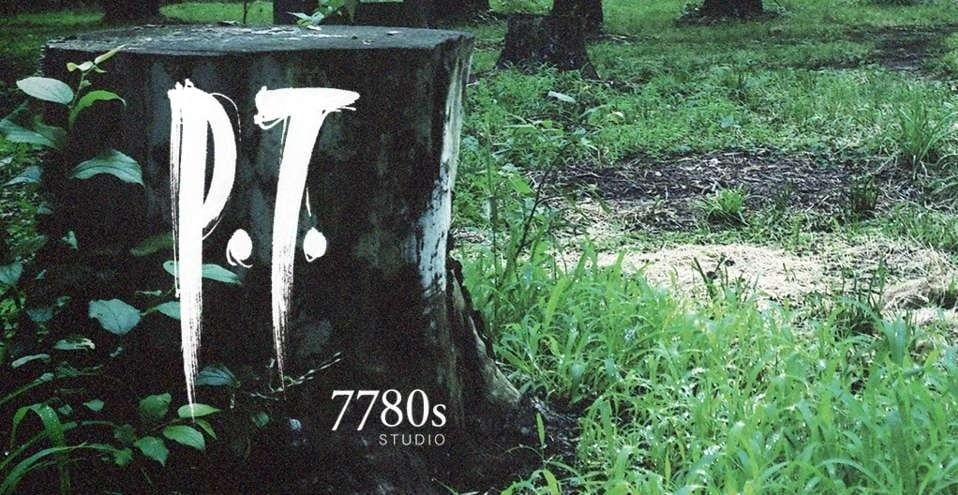

<p align="center">
  
</p>

<h1 align="center">P.T. for iOS</h1>

<p align="center">
  An experimental native iOS port. <strong>No CPU JIT.</strong>
</p>

<p align="center">
  
  
  
  
</p>

<p align="center">
  <a href="#status">Status</a> · <a href="#build">Build</a> · <a href="#controls">Controls</a> · <a href="docs/ios.md">Development notes</a> · <a href="#credits-and-license">Credits</a>
</p>

<p align="center">
  Based on <strong><a href="https://github.com/LoreanXavier/pt-pc">LoreanXavier/pt-pc</a></strong> and Hallway Engine.
</p>

---

> [!IMPORTANT]
> **Work in progress.** Touch controls, rendering, MetalFX, and performance are still being refined. Bugs and visual glitches are expected.

## The port

| | |
| :--- | :--- |
| **Native execution** | Ahead-of-time ARM64 C++; interpreted Lua 5.1. No CPU JIT or JIT fallback. |
| **Rendering** | Vulkan through MoltenVK, with optional MetalFX temporal upscaling. |
| **Input** | Touch controls through an SDL virtual Xbox-style gamepad, plus physical controllers. |
| **Display** | Reduced scene resolution with the phone's aspect ratio; fullscreen output and a separate UI canvas. |
| **Frame rate** | Up to a 120 FPS ceiling, with thermal and power management. Sustained performance depends on the device and scene. |

## Status

Earlier builds have been launched and played on an **iPhone 16 Pro**, including with a **DualShock 4**. Latest touch, fullscreen, and MetalFX changes still need physical-device verification. MetalFX can reduce performance and remains optional. Mac renderer tests and successful cross-builds do not establish iPhone FPS or full game completion.

This is an iOS adaptation of the original project, not an independent recreation of its engine. The source snapshot is based on upstream commit [`d0a9b8f`](https://github.com/LoreanXavier/pt-pc/commit/d0a9b8f).

**Bring your own game dump.** No game archives, PS4 executable, keys, saves, or resource-bearing IPA are included. The project does not download the game or decrypt packages. The header uses original promotional artwork; [artwork sources and rights](docs/branding/README.md) are recorded separately from the code license.

## Build

Requirements: Apple silicon Mac, Xcode with the iOS SDK, CMake, Ninja, and the Vulkan headers/tools. The current target is ARM64, iOS 18 or newer.

```sh
brew install cmake ninja vulkan-headers shaderc vulkan-loader
./script/build_ios.sh
```

The build script fetches a SHA-256-pinned MoltenVK iOS release and the upstream dependencies. It produces `dist/PT-iOS-unsigned.ipa`, **without the game**. Sign it for your own device before installing. No signing credentials are included.

At first launch, import your own extracted US P.T. dump (CUSA01127), containing:

- `chunk1.psarc`
- `texture.qar`
- `pathid_list_ps4.bin`

Imported resources and saves stay on the device. See [iOS build notes and validation history](docs/ios.md) for implementation details and limitations. Resource-bearing build options are for local use only; never commit or distribute their output.

## Controls

Left stick moves; right stick looks. **A** confirms/interacts, **B** goes back, **ZOOM** holds R3, and the pause button opens the menu. Touch controls reset on cancellation and application/window transitions. Touch sensitivity and multi-touch behavior are still being tested.

## Credits and license

- **LoreanXavier**: original [pt-pc](https://github.com/LoreanXavier/pt-pc) project, Hallway Engine, game implementation, and upstream work. The original MIT copyright and license are retained in [LICENSE](LICENSE).
- **IlieBanda**: iOS adaptation and device testing.
- iOS implementation and debugging were developed with assistance from OpenAI Codex. Test limitations are documented above and in the iOS notes.
- SDL, MoltenVK, Lua, fonts, and other dependencies retain their own licenses and notices. See `third_party/`, `assets/fonts/`, and the upstream documentation.

P.T. and its names, artwork, and original game content belong to their respective rights holders, including Konami. This is an unofficial project and is not affiliated with or endorsed by Konami or Kojima Productions. The source-code license does not grant rights to the game or its assets.
